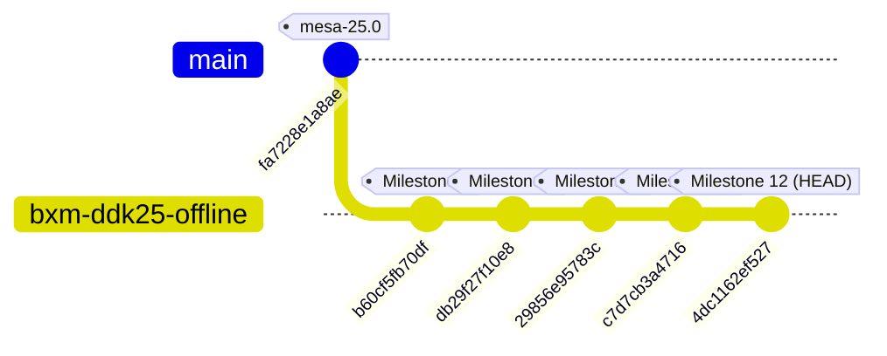

# Project Status & Comprehensive Knowledge Base: PowerVR BXM-8-256 Mesa Vulkan Driver

> **Document Purpose:** Authoritative, persistent documentation of project status, completed milestones, pending milestones, technical architecture, and agent handoff contexts for the open-source Turnip-like Mesa Vulkan driver (`vulkan_pvr`) targeting the Imagination Technologies PowerVR B-Series BXM-8-256 GPU.

---

## 1. Quick Agent Handoff / Executive Summary

If you are an incoming AI agent or engineer entering a new conversation context with token constraints:

1. **Mission:** Enable the upstream Mesa `vulkan_pvr` driver to execute on top of the stock Android kernel driver (`pvrsrvkm.ko`, DDK 25.1) on the Redmi Note 14 5G (`beryl`, MediaTek Dimensity 7025 / MT6855), without flashing firmware or replacing kernel modules.
2. **End-Goal Applications:**
   * **Eden / Yuzu forks** (Nintendo Switch emulation on Android via `adrenotools`).
   * **Azahar / Citra forks** (Nintendo 3DS emulation on Android via `adrenotools`).
   * **Winlator / Gamehub** (PC gaming on Android via Box64 + Wine + DXVK using Vulkan ICD loader).
3. **SAFETY FIRST (STRICT OFFLINE ONLY):**
   * **DO NOT** execute any command on the physical phone (`adb`, `fastboot`, shell).
   * **DO NOT** compile, push, or execute device probes. [`tools/pvr_connect_probe.c`](tools/pvr_connect_probe.c) is permanently frozen with `#error`.
   * **DO NOT** issue bridge ioctls or attempt physical GPU execution until authorized through gated safety protocols.
   * Work exclusively on the Linux host (`x86_64`) via static analysis, host mock tests, and Android cross-compilation.
4. **Current State:**
   * Level 1 (BVNC recognition) is **COMPLETE**.
   * Level 2 offline prerequisites (DDK 25.1 bridge ABI, PMR alloc/unref fix, B-Series heap topology, host regression suite, AArch64 cross-compilation) are **100% COMPLETE & VERIFIED**.
   * Level 3 packaging & compatibility:
     - **Dual HAL + ICD Loader model (Milestone 10): 100% COMPLETE**.
     - **Packaging automation tool (`tools/package_driver.py`): 100% COMPLETE**.
     - **Adrenotools `.zip` package (`dist/vulkan_pvr_bxm8256_adrenotools.zip`): 100% COMPLETE**.
     - **Standalone ICD manifest & `.zip` (`dist/vulkan_pvr_bxm8256_icd.zip`): 100% COMPLETE**.
     - **PCO Compiler & Device Limits (Milestone 12): 100% COMPLETE**.
   * Mesa branch: `bxm-ddk25-offline` in [`research/mesa-src`](research/mesa-src), clean working tree at commit `f1a4d5929bcf`.
   * Cross-compiled driver binary: [`research/mesa-src/build-android/src/imagination/vulkan/libvulkan_powervr_mesa.so`](research/mesa-src/build-android/src/imagination/vulkan/libvulkan_powervr_mesa.so) (12 MB ELF64, 0 non-Bionic dependencies).
   * Host regression test: [`tests/test_bridge_v25_mock`](tests/test_bridge_v25_mock) (passing 100%).

---

## 2. Hardware & Software Target Profile

| Component | Target Specification | Forensic / Verification Source |
| :--- | :--- | :--- |
| **Device Model** | Xiaomi Redmi Note 14 5G (Codename: `beryl`) | Device dumps / fastboot properties |
| **System on Chip** | MediaTek Dimensity 7025 (`MT6855`) | Device tree / /proc/cpuinfo |
| **GPU IP** | Imagination Technologies PowerVR B-Series BXM-8-256 | Vendor `vulkan.mtk.so` `VkPhysicalDeviceProperties` |
| **Hardware BVNC** | **`35.3.408.101`** (Packed uint64: `0x0023000301980065`) | String at `0xd70c2` & lookup table in `pvrsrvkm.ko` |
| **Vendor Device ID**| `0x35010101` (Vendor ID: `0x1010`) | Extracted from `device-info/vkjson.json` |
| **Stock Kernel Stack**| Imagination DDK `25.1@6715691` | Disassembly of `PVRSRVConnectKM` in `pvrsrvkm.ko` |
| **Kernel Module** | [`firmware/vendor-dlkm-files/lib/modules/pvrsrvkm.ko`](firmware/vendor-dlkm-files/lib/modules/pvrsrvkm.ko) | Vendor DLKM partition |
| **Vendor Userspace** | [`binaries/libsrv_um.so`](binaries/libsrv_um.so) & [`binaries/vulkan.mtk.so`](binaries/vulkan.mtk.so) | Extracted from `/vendor/lib64/` |
| **Target Driver** | Mesa `vulkan_pvr` (`libvulkan_powervr_mesa.so`) | Branch `bxm-ddk25-offline` in `research/mesa-src` |
| **Host Cross-Toolchain**| Android NDK r28 (`28.2.13676358`), Clang 19.0.1, API 34 | [`research/mesa-src/android-aarch64.ini`](research/mesa-src/android-aarch64.ini) |
| **Packaging Targets** | Adrenotools zip & Desktop/Winlator ICD zip | [`dist/`](dist/) generated by [`tools/package_driver.py`](tools/package_driver.py) |

---

## 3. Git Repository Architecture & Commit History

* **Mesa Submodule / Directory:** [`research/mesa-src`](research/mesa-src)
* **Base Upstream Commit:** `fa7228e1a8ae` ("docs: add sha256 checksum for mesa 25.0.0")
* **Active Branch:** `bxm-ddk25-offline` (clean working tree)



### Commit Details:

1. **Commit `b60cf5fb70df`:** *"imagination: Add provisional BXM-8-256 (35.3.408.101) device info"*
   * Added [`src/imagination/common/device_info/bxm-8-256.h`](research/mesa-src/src/imagination/common/device_info/bxm-8-256.h): definitions for BVNC `35.3.408.101`, feature flags, architectural parameters, and quirks.
   * Modified [`src/imagination/common/pvr_device_info.c`](research/mesa-src/src/imagination/common/pvr_device_info.c): registered `&pvr_device_info_35_3_408_101` in the device info lookup table.

2. **Commit `db29f27f10e8`:** *"imagination: Wire DDK 25.1 bridge ABI and B-Series heap fallback into pvrsrvkm winsys"*
   * Added [`src/imagination/vulkan/winsys/pvrsrvkm/pvr_srv_bridge_v25.h`](research/mesa-src/src/imagination/vulkan/winsys/pvrsrvkm/pvr_srv_bridge_v25.h): 25+ C11 `_Static_assert` compile-time checks, Group IDs, Function IDs, handle types, and packed structure definitions.
   * Modified `meson.build` and `src/imagination/vulkan/meson.build`: fixed sysroot `libz` and `libdrm` linkage for Android AArch64.
   * Modified `pvr_srv_bridge.c` & `pvr_srv_bridge.h`: dual-stack DDK 1.17 / DDK 25.1 runtime bridge dispatch.
   * Modified `pvr_srv_memctx.c`: added B-Series 16-heap discovery, skipped deferred `"General SVM"` (Heap 0), matched non-deferred `"General"` (Heap 1), and added fallback for absent `"TQ3DParameters"` heap.

3. **Commit `29856e95783c`:** *"imagination: Correct DDK 25.1 PMR allocation and unreference ABI and update verified BXM-8-256 features"*
   * Corrected `PVR_SRV_BRIDGE_MM_PMRUNREFPMR_V25` from Func 1 (`PMRUNEXPORTPMR`) to authoritative **Func 7 (`PMRUNREFPMR`)**.
   * Implemented DDK 25.1 branch in `pvr_srv_alloc_pmr()` for **Func 8 (`PHYSMEMNEWRAMBACKEDPMR`)** with 56-byte input and 20-byte output structures.
   * Added `if (!pmr) return;` guard in `pvr_srv_free_pmr()` and cleared `srv_bo->pmr = NULL` in `buffer_release()`.
   * Updated `bxm-8-256.h` with binary-extracted parameters from `pvrsrvkm.ko` `.rodata` tables: `num_clusters = 1`, `tile_size = 32x32`, `slc_cache_line_size = 1024`, `fbcdc_algorithm = 4`, `device_id = 0x35010101`.

4. **Commit `c7d7cb3a4716`:** *"vulkan: Export Vulkan ICD loader entrypoints in Android symbol map"*
   * Modified `src/vulkan/vulkan-android.sym` and `src/vulkan/vulkan-icd-android-symbols.txt` to export `vk_icdGetInstanceProcAddr`, `vk_icdGetPhysicalDeviceProcAddr`, and `vk_icdNegotiateLoaderICDInterfaceVersion` alongside `HMI`.
   * Configured static `libdrm` subproject linking (`-Dlibdrm:default_library=static`), completely eliminating `libdrm.so` from `DT_NEEDED`.
   * Enabled dual-mode operation: library functions simultaneously as an Android HAL module and a standalone Vulkan ICD.

5. **Commit `4dc1162ef527` (CURRENT HEAD):** *"imagination: Align compute workgroup and push constant limits with B-Series profile"*
   * Increased `PVR_MAX_PUSH_CONSTANTS_SIZE` in `src/imagination/common/pvr_limits.h` from 128 to 256 bytes, matching vendor device properties.
   * Dynamically enabled `maxComputeWorkGroupInvocations = 512U` and `maxComputeWorkGroupSize = { 512U, 512U, 64U }` in `pvr_physical_device.c` when `ERN35421` is present.
   * Fixed off-by-one assertion in `pvr_arch_cmd_buffer.c:6425` from `<` to `<=` to allow dispatches with full workgroup sizes up to the hardware maximum.

---

## 4. Master Milestone Roadmap

```
Legend: [X] Completed & Verified  |  [~] In Progress  |  [ ] Planned / Pending
```

### Phase 1: Reverse Engineering, Safety & Environment Setup
- [X] **M01: Repository Organization & Vendor Asset Ingestion**
  * Extracted `pvrsrvkm.ko`, `libsrv_um.so`, `vulkan.mtk.so` from firmware partitions.
  * Extracted and cataloged kernel crash logs (`crash/dropbox.txt`).
- [X] **M02: Forensic Crash Audit & Root Cause Analysis**
  * Identified bit-5 flag requirement (`0x20`) in `PVRSRVConnectKM` (`0x2c1d0`).
  * Dissected kernel callstack: `RemoveAndFreeStreamNode` Oops occurred because ASCII string `"s:27098\0"` was dereferenced as a pointer due to 32-bit compat client mode and deferred free deactivation (bit 7).
  * Permanently froze unsafe probe [`tools/pvr_connect_probe.c`](tools/pvr_connect_probe.c) with `#error`.
- [X] **M03: Native Toolchain & Cross-Build Environment Setup**
  * Built native host tools (`mesa_clc`, `vtn_bindgen2`, `pdsc_precomp`, `pco_clc`) in [`tools/native-bin/`](tools/native-bin/).
  * Configured Android NDK r28 cross-file [`research/mesa-src/android-aarch64.ini`](research/mesa-src/android-aarch64.ini).

### Phase 2: Driver Core Integration (Level 1 & Level 2 Offline)
- [X] **M04: BVNC `35.3.408.101` Device Profile Registration**
  * Added `bxm-8-256.h` and hooked into `pvr_device_info.c`.
  * Verified hardware constants directly against `pvrsrvkm.ko` internal `.rodata` tables.
- [X] **M05: Authoritative DDK 25.1 Bridge Dispatch Extraction**
  * Disassembled `Init*Bridge` routines and mapped all Bridge Groups (1, 2, 6, 11, 129).
  * Authored [`pvr_srv_bridge_v25.h`](research/mesa-src/src/imagination/vulkan/winsys/pvrsrvkm/pvr_srv_bridge_v25.h) with C11 static assertions.
- [X] **M06: B-Series 16-Heap Memory Topology Support**
  * Bypassed deferred `"General SVM"` (Heap 0) for device allocations.
  * Mapped dynamic allocations to 128 GB `"General"` space starting at `0x8000000000`.
  * Implemented `"TQ3DParameters"` heap fallback to `"General"`.
- [X] **M07: PMR Allocation & Release ABI Correction**
  * Resolved Func 1 vs Func 7 unref defect; resolved Func 10 vs Func 8 alloc defect.
  * Implemented packed 56-byte in / 20-byte out `PHYSMEMNEWRAMBACKEDPMR` handler.
- [X] **M08: Strengthened Host Regression Test Harness**
  * Implemented dispatch traps, handle type safety, double-free protection, and partial failure unwinding in [`tests/test_bridge_v25_mock.c`](tests/test_bridge_v25_mock.c).
- [X] **M09: Android AArch64 Cross-Compilation**
  * Generated 12 MB [`libvulkan_powervr_mesa.so`](research/mesa-src/build-android/src/imagination/vulkan/libvulkan_powervr_mesa.so) linking cleanly against Bionic sysroot.

### Phase 3: Loader Compatibility, Shims & Packaging (Current Phase)
- [X] **M10: Dual HAL & Standalone ICD Loader Shim / Packaging**
  * Exported `HMI`, `vk_icdGetInstanceProcAddr`, `vk_icdGetPhysicalDeviceProcAddr`, and `vk_icdNegotiateLoaderICDInterfaceVersion`.
  * Statically linked `libdrm` subproject into the driver `.so`, eliminating non-Bionic runtime dependencies.
  * Authored [`tools/package_driver.py`](tools/package_driver.py) automating binary validation, symbol checks, DT_NEEDED verification, and zip packaging:
    - Rootless Adrenotools zip: [`dist/vulkan_pvr_bxm8256_adrenotools.zip`](dist/vulkan_pvr_bxm8256_adrenotools.zip) with `meta.json` (for Eden / Azahar).
    - Standalone ICD package: [`dist/vulkan_pvr_bxm8256_icd.zip`](dist/vulkan_pvr_bxm8256_icd.zip) with manifest [`dist/standalone_icd/powervr_icd.aarch64.json`](dist/standalone_icd/powervr_icd.aarch64.json) (for Winlator / Gamehub / DXVK / Box64).
- [X] **M12: PCO Compiler Workgroup & Register Allocation Audit**
  * Verified PCO register allocator (`pco_ra.c`), workgroup barrier lowering (`pco_nir_sync.c`), and USRM register clamping (`rogue_max_wg_temps`).
  * Expanded push constant size to 256 bytes (`PVR_MAX_PUSH_CONSTANTS_SIZE`) to match vendor profile.
  * Dynamically advertised compute workgroups up to 512 invocations (`ERN35421`), enabling modern emulator compute dispatches.
  * Fixed off-by-one assertion bug in `pvr_arch_cmd_buffer.c:6425` (`<` changed to `<=`).
- [ ] **M11: DRM-Shim / Mock Device Pipeline Verification**
  * *Objective:* Configure Mesa's DRM-shim or a host winsys wrapper to mock `/dev/dri/renderD128` on the Linux host so that command-stream generation (`pvr_cmd_buffer.c`) and SPIR-V pipeline compilation can be exercised offline without hardware access.

### Phase 4: Driver Capability Expansion & Vulkan Feature Roadmap (Things To Do)
- [ ] **M17: Native ASTC Texture Compression (`textureCompressionASTC_LDR`)**
  * *Context:* BXM-8-256 TPU (Texture Processing Unit) has native hardware ASTC decompression (`1.0` in vendor driver). Currently disabled in Mesa because [`pvr_formats.c`](research/mesa-src/src/imagination/vulkan/pvr_formats.c) only defines ETC2 formats.
  * *Task:* Populate `pvr_formats.c` format capability tables for `VK_FORMAT_ASTC_*_KHR` with hardware format bitfields and block dimensions. Crucial for Nintendo Switch (Eden/Yuzu) and 3DS (Azahar/Citra) emulators.
- [ ] **M18: Image Synthesis Processor (ISP) Depth Clamping (`depthClamp`)**
  * *Context:* Currently disabled (`depthClamp = false`). PowerVR's Tile Accelerator (TA) clips primitives outside the near/far frustum by default.
  * *Task:* Hook depth-clamp state into ISP command packets in [`pvr_arch_cmd_buffer.c`](research/mesa-src/src/imagination/vulkan/pvr_arch_cmd_buffer.c) to clamp fragment depth instead of clipping primitives.
- [ ] **M19: Descriptor Indexing & Bindless Resource Lowering (`descriptorIndexing`)**
  * *Context:* Currently disabled (`descriptorIndexing = false`, `runtimeDescriptorArray = false`). PowerVR uses Parameter Data Streamer (PDS) programs that statically bind descriptors ahead of time, which fails on dynamic/runtime array indices (`textures[dynamic_id]`).
  * *Task:* Implement a NIR lowering pass that converts dynamic descriptor indexing into direct 64-bit GPU memory loads (mirroring Turnip's `tu_descriptor_set.c` approach) or generate dynamic looping PDS programs. Required for modern PC titles (Winlator / DXVK) and advanced Switch games.
- [ ] **M20: 64-bit Integer & 8-bit Storage Lowering (`shaderInt64`, `storageBuffer8BitAccess`)**
  * *Context:* PowerVR ALUs are 32-bit/16-bit. Vendor driver emulates Int64 via register pairs (low/high) and carry/borrow ALU flags.
  * *Task:* Hook `nir_lower_int64` and `nir_lower_bit_size` in the PCO compiler backend to enable 64-bit integer arithmetic and 8-bit storage buffer packing/unpacking.
- [ ] **M21: Multi-Viewport State Routing (`multiViewport`)**
  * *Context:* Hardware Primitive Processing Pipe (PPP) supports multiple viewports, but Mesa currently hardcodes `PVR_MAX_VIEWPORTS = 1`.
  * *Task:* Expand viewport tracking structures in `pvr_cmd_buffer.c` and populate PPP multi-viewport state registers.
- [ ] **M22: Geometry & Tessellation Pipeline Emulation (Long-Term)**
  * *Context:* PowerVR TBDR architecture lacks fixed-function geometry/tessellation hardware units. The vendor driver emulates GS and Tessellation by compiling them into multi-pass compute-like vertex streaming passes via intermediate Parameter Buffers (PB).
  * *Task:* Design intermediate PB stream generation in PCO to support `VK_SHADER_STAGE_GEOMETRY_BIT` and `VK_SHADER_STAGE_TESSELLATION_*`.
- [ ] **M23: BC (DXTC) Texture Decompression Compute Shaders (Winlator Compatibility)**
  * *Context:* BXM-8-256 mobile silicon has **no hardware BC decompression unit** (`textureCompressionBC = 0.0` on vendor driver). Desktop games using BC1–BC7 will fail unless transcoded.
  * *Task:* Implement compute-shader format decompression or hook into DXVK's format emulation layer to transcode BC textures to uncompressed/ASTC formats.

### Phase 5: Gated, Reversible Physical Device Validation (Strictly Suspended)
- [ ] **M13: Pre-Flight Safety Verification Gate** (Battery > 50%, USB direct, logcat background monitor).
- [ ] **M14: Non-Invasive App-Private Deployment** (Deploy exclusively in `/data/local/tmp/mesa-test/` or via in-app Adrenotools; zero system/vendor partition modifications).
- [ ] **M15: Isolated Device & Context Enumeration** (Verify Bridge 1 connect and Bridge 6 memory context creation without command submission).
- [ ] **M16: Minimal Compute Workload Execution** (Execute single 1-workgroup compute shader writing 1 integer to verify end-to-end hardware execution).

---

## 5. Technical Deep-Dive & Architecture Reference

### 5.1 Authoritative DDK 25.1 Bridge Dispatch Table

Extracted directly from `_SetDispatchTableEntry` registration in `pvrsrvkm.ko`:

| Bridge Group | Function ID | Function Name | In Size | Out Size | Critical Notes |
| :--- | :--- | :--- | :--- | :--- | :--- |
| **Bridge 1 (Core)** | Func 0 | `SRVCORE_CONNECT` | 16 B | 17 B | Requires `ui32Flags = 0x20` (bit 5). Out: BVNC (8B), Error (4B), Caps (4B), Arch (1B). |
| **Bridge 1 (Core)** | Func 1 | `SRVCORE_DISCONNECT` | 0 B | 4 B | Clean connection release. |
| **Bridge 6 (MM)** | Func 1 | `PMRUNEXPORTPMR` | 8 B | 4 B | Unexports PMR export handle. **Do not use for unref!** |
| **Bridge 6 (MM)** | Func 7 | `PMRUNREFPMR` | 8 B | 4 B | In: `hPMR` (Type 4). Destroys PMR handle in kernel. |
| **Bridge 6 (MM)** | Func 8 | `PHYSMEMNEWRAMBACKEDPMR` | 56 B | 20 B | In: size, mapping_table, annotation, PID, flags. Out: `hPMR` (offset 0), `error` (offset 8), `flags` (offset 12). |
| **Bridge 6 (MM)** | Func 9 | `DEVMEMINTCTXCREATE` | 1 B | 24 B | Out: `hServerMemCtx` (Type 7) and `hServerMemCtxData` (Type 38). |
| **Bridge 6 (MM)** | Func 10 | `DEVMEMINTCTXDESTROY` | 8 B | 4 B | In: `hServerMemCtx` (Type 7). |
| **Bridge 6 (MM)** | Func 11 | `DEVMEMINTHEAPCREATE` | 16 B | 12 B | In: MemCtx (8B), CfgIdx (4B), HeapIdx (4B). Out: `hServerHeap` (Type 9). |
| **Bridge 6 (MM)** | Func 12 | `DEVMEMINTHEAPDESTROY` | 8 B | 4 B | In: `hServerHeap` (Type 9). |
| **Bridge 6 (MM)** | Func 21 | `HEAPCFGHEAPCONFIGCOUNT`| 0 B | 8 B | Out: `ui32NumHeapConfigs`, `ui32Error`. |
| **Bridge 6 (MM)** | Func 22 | `HEAPCFGHEAPCOUNT` | 4 B | 8 B | In: `ui32HeapConfigIndex`. Out: `ui32NumHeaps`, `ui32Error`. |
| **Bridge 6 (MM)** | Func 24 | `HEAPCFGHEAPDETAILS` | 20 B | 44 B | Out: Base (8B), Size (8B), Log2Page (4B), `szHeapName[20]`. |
| **Bridge 6 (MM)** | Func 30 | `DEVMEMXINTRESERVERANGE`| 24 B | 12 B | In: DevVAddr (8B), Size (8B), Heap (8B). Out: `hReservation` (Type 11). |
| **Bridge 6 (MM)** | Func 31 | `DEVMEMXINTUNRESERVERANGE`| 8 B | 4 B | In: `hReservation` (Type 11). |
| **Bridge 6 (MM)** | Func 32 | `DEVMEMXINTMAPPAGES` | 36 B | 4 B | In: PMR (8B), Res (8B), PageCount (4B), Offsets (8B), Flags (8B). |
| **Bridge 6 (MM)** | Func 33 | `DEVMEMXINTUNMAPPAGES` | 16 B | 4 B | In: Res (8B), PageCount (4B), Offset (4B). |
| **Bridge 11 (DMABUF)**| Func 0 | `PHYSMEMIMPORTDMABUF` | 24 B | 28 B | In: buffer_fd, flags, name. Out: align (8B), size (8B), PMR (8B), error (4B). |
| **Bridge 11 (DMABUF)**| Func 1 | `PHYSMEMEXPORTDMABUF` | 8 B | 8 B | In: `hPMR`. Out: `ui32Error` (offset 0, 4B), `iFd` (offset 4, 4B). |
| **Bridge 129 (CMP)**| Func 0 | `RGXCREATECOMPUTECONTEXT`| 56 B | 12 B | In: takes `hServerMemCtxData` (Type 38 at offset 8). Out: `hComputeContext` (Type 22). |
| **Bridge 129 (CMP)**| Func 1 | `RGXDESTROYCOMPUTECONTEXT`| 8 B | 4 B | In: `hComputeContext` (Type 22). |
| **Bridge 129 (CMP)**| Func 8 | `RGXKICKCDM` | 112 B | 12 B | Submit compute kick to firmware. |

### 5.2 B-Series 16-Heap Memory Topology (Discovered on Hardware)

```text
Config 0: 16 Heaps Total
[Heap 0]  "General SVM"          Base: 0x000000008000  Size: 512 GB  (Deferred demand paging - explicitly bypassed by Mesa)
[Heap 1]  "General"              Base: 0x008000000000  Size: 128 GB  (Active device heap for all dynamic allocations)
[Heap 2]  "General NON-4K"       Base: 0x00b800000000  Size: 32 GB   (16KB page heap)
[Heap 3]  "PDS Code and Data"    Base: 0x00da00000000  Size: 4 GB
[Heap 4]  "USC Code"             Base: 0x00e000000000  Size: 4 GB
[Heap 5]  "Vulkan Capture Replay"Base: 0x00e900000000  Size: 1 GB
[Heap 6]  "Component Control"    Base: 0x00eb00000000  Size: 4 GB
[Heap 7]  "FBCDC"                Base: 0x00ec00000000  Size: 2 MB
[Heap 8]  "Large FBCDC"          Base: 0x00ec40000000  Size: 2 MB
[Heap 9]  "PDS Indirect State"   Base: 0x00ed00000000  Size: 16 MB
[Heap 10] "Compute Mission RMW"  Base: 0x00ee00000000  Size: 1 GB
[Heap 11] "Compute Safety RMW"   Base: 0x00ef00000000  Size: 1 GB
[Heap 12] "Texture State"        Base: 0x00f000000000  Size: 4 GB
[Heap 13] "Visibility Test"      Base: 0x00f200000000  Size: 2 MB
[Heap 14] "PM Meta Protected"    Base: 0x00fa00000000  Size: 1 GB
[Heap 15] "PM Only"              Base: 0x00fa40000000  Size: 1 GB
```

### 5.3 Forensic Crash Audit (Dropbox Dissection)

* **Crash Location:** `RemoveAndFreeStreamNode+0x34` (`0x333b8`) called from `TLStreamClose+0x4c` (`0x35024`) during `ConnectionDataDestroy`.
* **Kernel Exception:** Oops 0000000096000044 (Unable to handle kernel paging request at virtual address `0x0038393037323a73`).
* **Root Finding:** The string `"s:27098\0"` (Transport Layer stream name for PID 27098) was read as a pointer in register `x9` during list unlinking (`ldp x8, x9, [x0]; str x8, [x9]`).
* **Causal Link:** `PVRSRVConnectKM` checks bit 5 (`ui32Flags & 0x20`). When missing, the kernel forces 32-bit compatibility mode (`strb w11, [x22, #32] = 2`). Furthermore, bit 7 (`0x80`) triggers `TLDeactivateDeferredFree` in `ConnectionDataDestroy`. The probe tool mistakenly passed `0x80` instead of `0x20`, corrupting stream cleanup.

### 5.4 Hardware vs. Software Vulkan Feature Capabilities & Limitations

| Feature | Physical BXM Silicon Support? | Stock Vendor Driver (`vulkan.mtk.so`) | Mesa `vulkan_pvr` | Implementation Status & Path Forward |
| :--- | :---: | :---: | :---: | :--- |
| **Geometry Shaders** | ❌ Emulated in SW | ✅ (via compute/PDS) | ❌ (`false`) | Driver only compiles VS & FS; requires intermediate Parameter Buffer (PB) streaming |
| **Tessellation Shaders**| ❌ Emulated in SW | ✅ (via compute/PDS) | ❌ (`false`) | No tessellation control/evaluation pipeline in PCO compiler |
| **Descriptor Indexing** | ✅ (Indirect lookups) | ✅ | ❌ (`false`) | PDS statically bakes descriptors; requires NIR indirect load lowering to global memory |
| **ASTC Textures** | ✅ Native HW TPU | ✅ | ❌ (`false`) | Hardware TPU supports ASTC; `pvr_formats.c` needs format table bitfield mapping |
| **BC (DXTC) Textures** | ❌ **No HW Silicon** | ❌ (`0.0`) | ❌ (`false`) | Hardware lacks BC decompression units; requires compute shader decompression |
| **64-bit Float (`FP64`)**| ❌ **No HW Silicon** | ❌ (`0.0`) | ❌ (`false`) | USC ALUs are strictly 32-bit/16-bit; no double-precision hardware units |
| **64-bit Integer** | ⚠️ Register Pairing | ✅ | ❌ (`false`) | Requires 64-bit register-pair ALU lowering (`nir_lower_int64`) in PCO backend |
| **Depth Clamping** | ✅ Native in ISP | ✅ | ❌ (`false`) | Requires hooking depth-clamp bit in Image Synthesis Processor (ISP) command packets |
| **Multi-Viewport** | ✅ Native in PPP | ✅ | ❌ (`false`) | Hardcoded to single viewport (`PVR_MAX_VIEWPORTS = 1`) |

---

## 6. Standard Build & Packaging Procedures (Host Only)

### 6.1 Running the Host Regression Test Harness
```bash
gcc -Wall -Wextra -Werror -O2 \
  /home/ameya/bxm-research/tests/test_bridge_v25_mock.c \
  -o /home/ameya/bxm-research/tests/test_bridge_v25_mock

/home/ameya/bxm-research/tests/test_bridge_v25_mock
```

### 6.2 Cross-Compiling Driver for Android AArch64
```bash
export PATH="/home/ameya/bxm-research/tools/native-bin:$PATH"

ninja -C /home/ameya/bxm-research/research/mesa-src/build-android \
  src/imagination/vulkan/libvulkan_powervr_mesa.so
```

### 6.3 Packaging Driver Zips for Emulators (Adrenotools & ICD)
```bash
python3 /home/ameya/bxm-research/tools/package_driver.py
```

### 6.4 Checking Binary Dependencies & Symbols
```bash
# Verify exported symbols
aarch64-linux-gnu-nm -D \
  /home/ameya/bxm-research/research/mesa-src/build-android/src/imagination/vulkan/libvulkan_powervr_mesa.so | grep -E " T | D "

# Verify DT_NEEDED dynamic dependencies (should only show Bionic libraries)
aarch64-linux-gnu-readelf -d \
  /home/ameya/bxm-research/research/mesa-src/build-android/src/imagination/vulkan/libvulkan_powervr_mesa.so | grep NEEDED
```

---

## 7. Open Technical Challenges & Immediate Next Steps

1. **Offline DRM-Shim Pipeline Verification (Milestone 11):**
   * *Action:* Configure Mesa's `powervr_noop_drm_shim` or implement a host winsys wrapper that mocks `/dev/dri/renderD128`, enabling offline testing of SPIR-V pipeline compilation, PDS program generation, and CDM command building before touching hardware.
2. **Prioritized Feature Implementations (Milestones 17–20):**
   * *M17 (Native ASTC):* Populate `VK_FORMAT_ASTC_*` entries in `pvr_formats.c` to unlock standard textures in Nintendo Switch (Eden/Yuzu) and 3DS (Azahar/Citra) emulation.
   * *M18 (Depth Clamping):* Hook depth-clamp state into ISP command packets in `pvr_arch_cmd_buffer.c`.
   * *M19 (Descriptor Indexing):* Port Turnip-like indirect descriptor buffer lowering to NIR to unlock modern Winlator/DXVK games.
   * *M20 (Int64 / Int8):* Enable `nir_lower_int64` and `nir_lower_bit_size` in the PCO backend compiler.
3. **Physical Device Testing Freeze:**
   * **STRICT SAFETY CONSTRAINT:** Do NOT attempt physical testing on the device until offline DRM-shim and pipeline compilation are fully validated and user authorization is provided.
